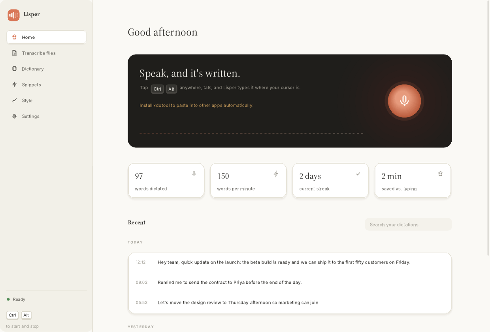
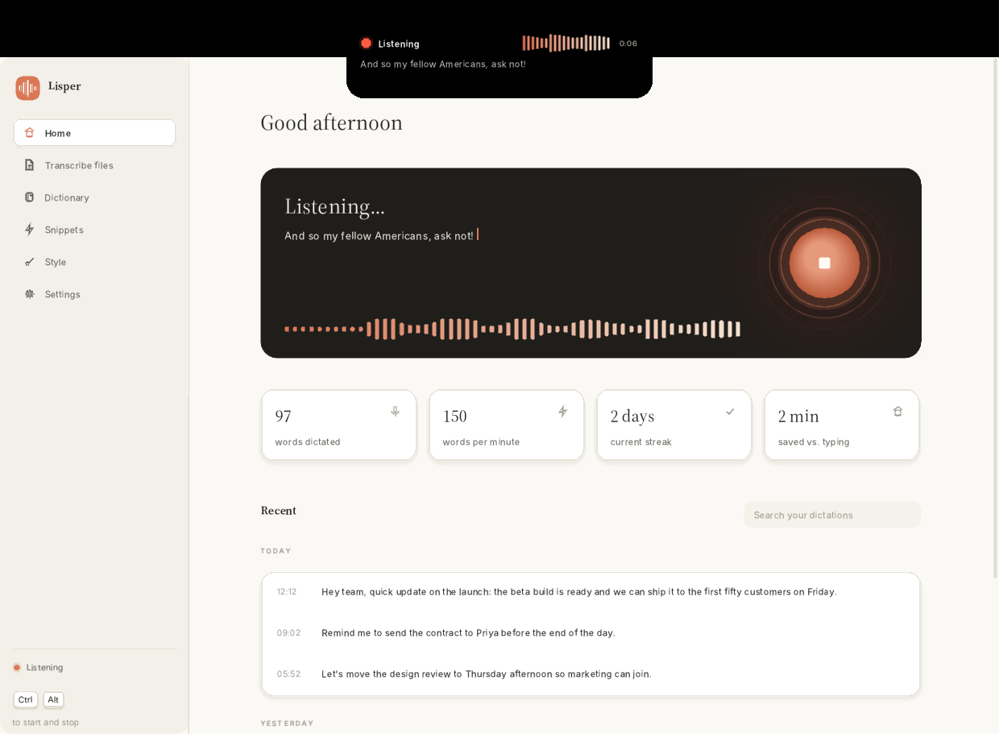
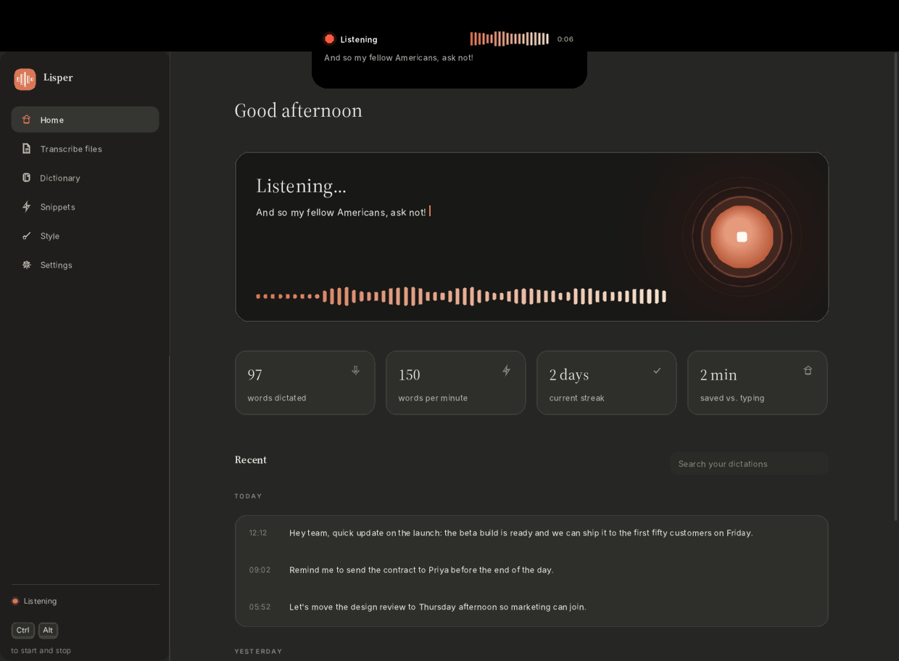

# Lisper

<div align="center">

**Private, on-device voice dictation and transcription.**
Press a shortcut in any app, speak, and Lisper types it for you, cleaned up and spelled your way.
Nothing leaves your computer.

[](LICENSE)
[](https://en.wikipedia.org/wiki/C%2B%2B17)
[](BUILDING.md)
[](docs/MCP.md)



</div>

## What it does

**Dictate anywhere.** On a Mac, tap <kbd>⌘</kbd> and <kbd>⌥</kbd> together in any text field
(on Windows and Linux: <kbd>Ctrl</kbd>+<kbd>Shift</kbd>+<kbd>Space</kbd>; any shortcut or modifier
chord works, as a toggle or hold-to-talk). A black island grows out of the MacBook notch, shows
your voice as a live waveform and **writes your words as you speak**. Tap again and Lisper
finishes the transcript locally with [whisper.cpp](https://github.com/ggerganov/whisper.cpp),
cleans it up and types it where your cursor is. When it's idle, the island hides back in the notch.

<div align="center">

</div>

- **Cleanup:** removes filler words ("um", "uh"), understands "new line" / "new paragraph",
  formal or casual style.
- **Dictionary:** fix words it mishears ("lisa per" → "Lisper") and give it vocabulary
  (names, jargon, acronyms) so it spells them right the first time.
- **Snippets:** say "my calendar link" and get the full URL, an address, or a sign-off.
- **History and stats:** searchable local history, words dictated, words per minute,
  streak and time saved. Can be switched off.
- **99 languages**, auto-detected, with optional translation to English.

**Transcribe files.** Drop in recordings, meetings or videos (WAV, MP3, M4A, FLAC, OGG, MP4, MOV,
MKV, WEBM, ...) and get text, SRT subtitles, JSON with timestamps, or RAG-ready chunks.
The CLI adds batch and watch-folder modes.

**Use it from AI assistants.** `lisper-mcp` is a [Model Context Protocol](https://modelcontextprotocol.io)
server, so Claude Desktop, Claude Code, Cursor, VS Code and other MCP clients can transcribe files
or take dictation through Lisper, still fully on-device. See [docs/MCP.md](docs/MCP.md).

<div align="center">


</div>

## Install

Build from source (see [BUILDING.md](BUILDING.md) for platform details):

```bash
git clone --recursive https://github.com/Lagmator22/Lisper.git
cd Lisper
cmake -B build -DCMAKE_BUILD_TYPE=Release
cmake --build build -j
sudo cmake --install build      # optional: installs lisper, lisper_gui, lisper-mcp
```

Requirements: CMake 3.14+, a C++17 compiler, FFmpeg (for non-WAV input), SDL2 ≥ 2.0.18
(for the desktop app and microphone), and curl (for model downloads).

Then start the app and download a model from **Settings → Speech model**, or from the CLI:

```bash
lisper --model-profile quality --download-model
```

### Platform notes

| | Global shortcut | Paste into apps | Notes |
|---|---|---|---|
| **macOS** | Built in (default: tap ⌘⌥) | Built in | Grant **Microphone** and **Accessibility** access when prompted. The island sits in the notch on MacBooks, or hangs from the menu bar on other displays. |
| **Windows** | Built in | Built in | Apps running as administrator can't receive paste from a normal app. |
| **Linux (X11)** | Built in | Install `xdotool` | |
| **Linux (Wayland)** | Bind a system shortcut to `lisper_gui --toggle` | Install `wtype` | Compositors don't allow apps to grab global keys. |

## Using the desktop app

```bash
lisper_gui                 # start (a second launch focuses the running app)
lisper_gui --toggle        # start/stop dictation in the running app
lisper_gui --minimized     # start in the background
lisper_gui recording.m4a   # open a file on the Transcribe page
```

Closing the window minimizes Lisper so the shortcut keeps working (configurable).
Use **Settings → Quit Lisper** to exit.

**Shortcuts.** Tap the shortcut to start and tap again to insert, or switch to hold-to-talk.
Modifier-only chords such as ⌘⌥ only fire on a clean tap, so ⌘⌥Esc, ⌘⌥-drag or AltGr typing never
start a dictation. Record any shortcut in **Settings → Shortcut**.

**The island** shows a live waveform from your microphone, a timer, and your words while you
talk (turn off *Live preview* to save CPU on slow machines). Click it to stop. If Lisper can't paste
into the app (for example a missing `xdotool` on Linux), the island says *Copied* and the text is
on your clipboard.

| Page | What's there |
|---|---|
| Home | Dictation card, stats, searchable history (copy or delete entries) |
| Transcribe files | Drop zone, output format, save location, transcript preview |
| Dictionary | Replacements and vocabulary |
| Snippets | Spoken cues that expand to text |
| Style | Formal/casual, filler removal, voice commands |
| Settings | Shortcut, microphone, insertion, live preview, island position, sounds, model, language, theme, privacy, MCP setup |

## Command line

```bash
lisper --model-profile quality recording.wav                 # print transcript
lisper --model-profile quality video.mp4 -f srt -o video.srt  # subtitles
lisper -m model.bin podcast.mp3 -f json -o transcript.json   # timestamps
lisper --model-profile quality -d ./recordings -o ./out      # batch a folder
lisper --model-profile quality -w ./inbox -o ./out -f srt    # watch a folder
lisper --model-profile fast --live                           # live mic (Ctrl+C to stop)
lisper -l auto --translate interview.mp3                     # any language → English
```

Run `lisper --help` for all options.

### Model profiles

| Profile | Model | Size | Use case |
|---|---|---|---|
| `tiny` | tiny | 75 MB | Instant dictation on any machine, quick tests |
| `fast` | small-q5_1 | 190 MB | Fast drafts on CPU |
| `balanced` | medium-q5_0 | 514 MB | Everyday transcripts |
| `quality` | large-v3-turbo-q5_0 | 574 MB | Best quality/speed trade-off (default) |
| `max` | large-v3 | 3.1 GB | Maximum accuracy |

Models are stored per user (`~/Library/Application Support/Lisper/models`, `%APPDATA%\Lisper\models`,
or `~/.local/share/lisper/models`); override with `LISPER_MODELS_DIR`.

### Output formats

| Format | Flag | Description |
|---|---|---|
| Text | `-f text` | Plain transcript (default) |
| SRT | `-f srt` | Subtitles with timestamps |
| JSON | `-f json` | Text plus timestamped segments and detected language |
| RAG | `-f rag` | ~400-character chunks split at sentence boundaries, for vector databases |

## Privacy and security

- Speech is transcribed on your device. Audio is never uploaded and recordings are not saved.
- Settings and history are stored in your user profile with owner-only permissions.
  History can be disabled or cleared.
- The only network access is downloading models from Hugging Face over HTTPS, when you ask for it.
- External tools (ffmpeg, curl, paste helpers) are launched without a shell, and ffmpeg is limited
  to local files.

See [SECURITY.md](SECURITY.md) for the threat model and how to report a vulnerability.

## Project layout

```
src/
  lisper.*          Engine (whisper.cpp wrapper, thread-safe, cancellable)
  media.*           Audio preparation via ffmpeg (shell-free)
  text_cleanup.*    Fillers, voice commands, dictionary, snippets, style
  settings.*        Persistent settings (JSON)
  history.*         Dictation history and stats (JSONL)
  audio_capture.*   Microphone capture (SDL2)
  mcp_server.*      MCP server; mcp_main.cpp is the lisper-mcp entry point
  main.cpp          CLI
  gui_app.cpp       Desktop app shell
  gui/              Pages, theme, dictation controller, notch island,
                    global shortcuts and chords, paste, platform glue
                    (platform_mac.mm), single-instance control
tests/              Unit tests (ctest)
docs/               MCP, GUI architecture, API, models
```

## Contributing

See [CONTRIBUTING.md](CONTRIBUTING.md). Build with `-DLISPER_BUILD_TESTS=ON` and run `ctest`.

## License

MIT. See [LICENSE](LICENSE) and [THIRD_PARTY_NOTICES.md](THIRD_PARTY_NOTICES.md).
